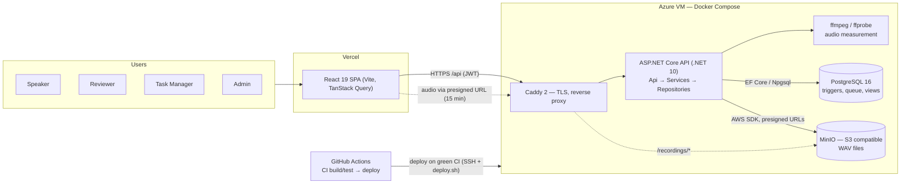
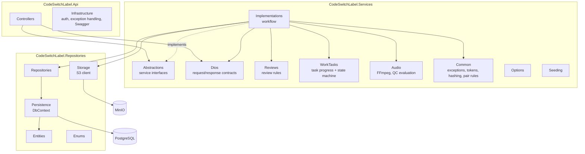
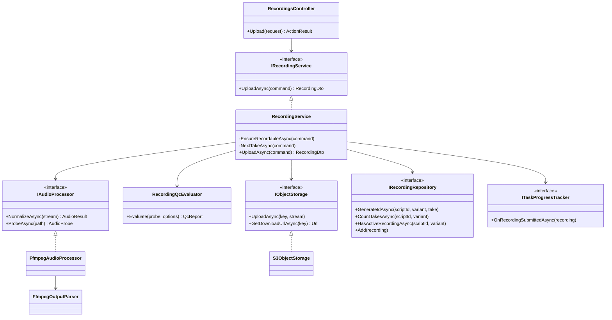
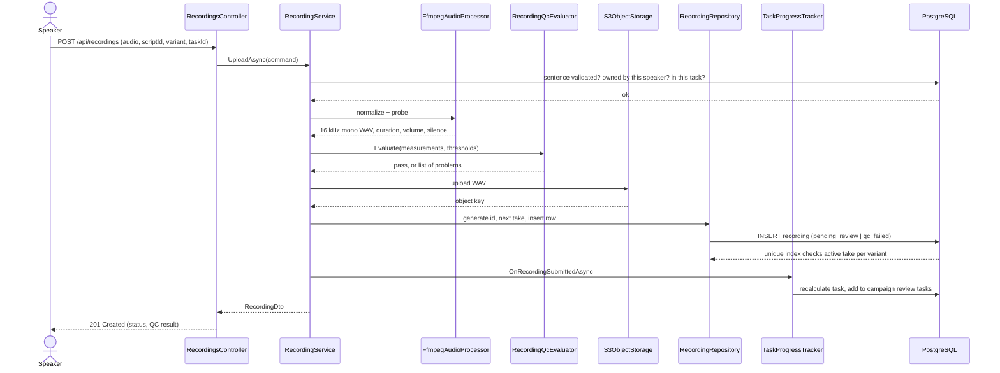
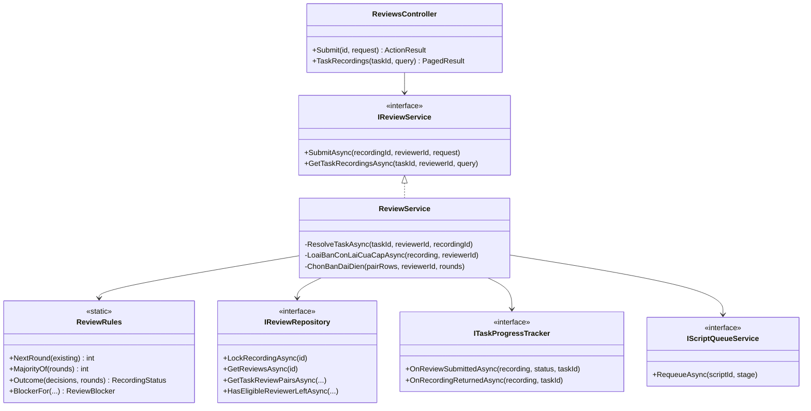
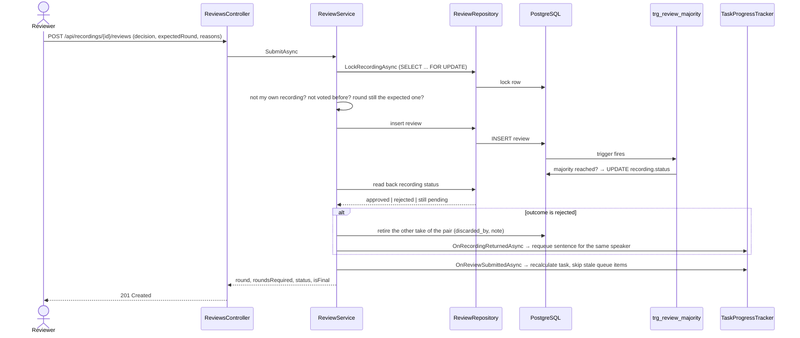
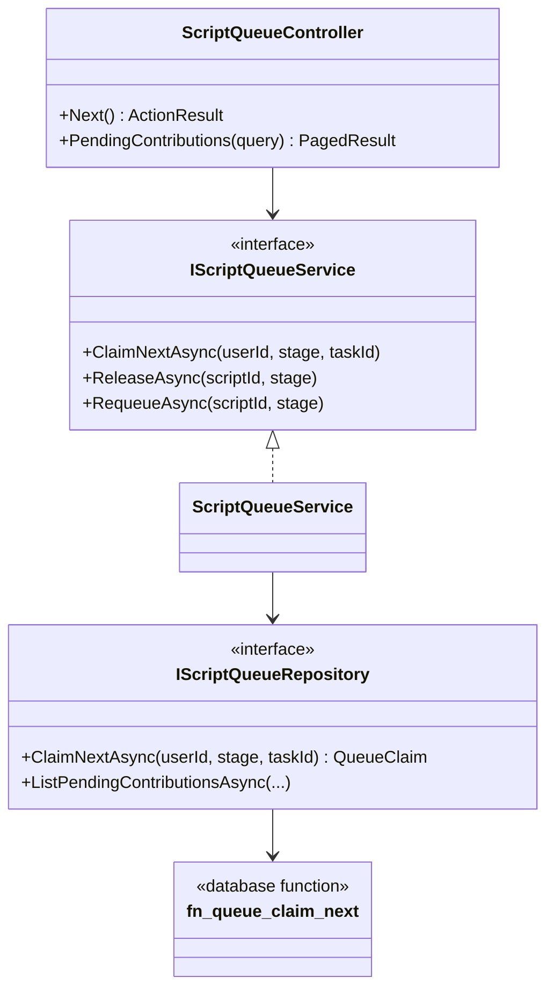
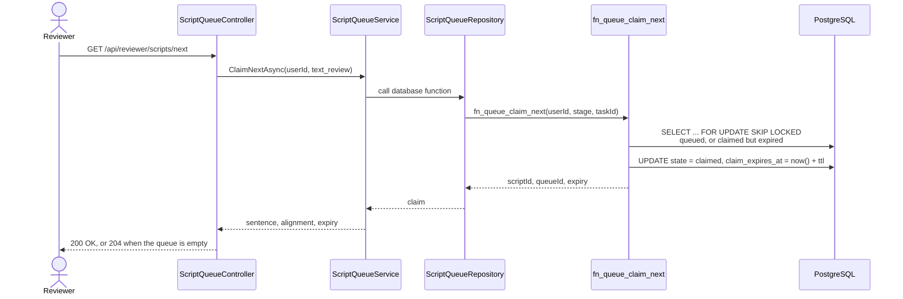

# Nội dung cho Report 4 — Software Design Document

Soạn sẵn để dán sang Google Docs. Viết bằng tiếng Anh cho khớp bộ tài liệu capstone.

Các sơ đồ viết bằng **Mermaid**: copy khối code, dán vào [mermaid.live](https://mermaid.live),
xuất PNG rồi chèn vào doc. Sơ đồ kiến trúc và ERD đã có sẵn trong repo
(`docs/diagrams/01-architecture.mmd`, `02-erd.mmd`) nên dùng lại, không vẽ mới.

Mọi tên lớp, tên bảng, khoá chính và khoá ngoại dưới đây **đọc từ mã nguồn và từ cơ sở dữ liệu
đang chạy**, không phải mô tả mong muốn.

---

## 1.1 System Architecture

> Thay cho mục `II. 1.1 System Architecture`. Sơ đồ: dùng `docs/diagrams/01-architecture.mmd`.

The system is a three-tier web application deployed as a set of Docker containers on a single
virtual machine, with the single-page front end hosted separately.

### Component descriptions

| Component | Technology | Responsibility |
|---|---|---|
| Single-page application | React 19, Vite, TanStack Query, hosted on Vercel | All four role interfaces. Holds no business rules; every decision is taken by the API. |
| Reverse proxy | Caddy 2 | Terminates TLS with certificates obtained and renewed automatically, routes `/api` to the application and `/recordings/*` to object storage, and caps request bodies at 25 MB. |
| Application | ASP.NET Core on .NET 10 | The REST API. Three layers: controllers accept and authorise requests, services hold the workflow, repositories reach the database and storage. |
| Audio analyser | FFmpeg and FFprobe, invoked as local processes | Measures duration, mean volume, peak level and silence at both ends of every upload before a human sees it. |
| Database | PostgreSQL 16 | All persistent data. Also the place where the business invariants live, as CHECK constraints, unique indexes and triggers — so a direct SQL write cannot corrupt the corpus. |
| Object storage | MinIO, S3-compatible | Audio files. The application never serves audio bytes; it issues presigned links that expire after 15 minutes. |
| Delivery pipeline | GitHub Actions | Builds the solution with warnings treated as errors, runs the full test suite against a real PostgreSQL instance, and on success deploys over SSH: backup, pull, apply migrations, rebuild containers, health-check. |

### Why the invariants sit in the database

The corpus is the deliverable of this project, and it is written by four roles through several
paths — the API, data imports, and the occasional operational fix. Putting the rules that protect
it in application code would leave every other path unguarded. Rules such as *both halves of a pair
are read by the same voice*, *one active take per variant*, *a released dataset is immutable* and
*the sentence identifier must agree with the sentence's own word count and topic* are therefore
enforced by triggers and constraints, and the application layer only translates a violation into a
readable message.

---

## 1.2 Package Diagram

> Thay cho mục `1.2`.

### Package descriptions

| No | Package | Description |
|---|---|---|
| 01 | `CodeSwitchLabel.Api.Controllers` | HTTP endpoints. Each action declares the roles allowed to call it; no business decision is taken here. |
| 02 | `CodeSwitchLabel.Api.Infrastructure` | Authentication, the global exception handler that turns a domain exception into a problem response with a stable code, and the OpenAPI setup. |
| 03 | `CodeSwitchLabel.Services.Abstractions` | Interfaces the controllers depend on, one per functional area. Keeps the API free of implementation details and makes the services testable. |
| 04 | `CodeSwitchLabel.Services.Implementations` | The workflows: sentence intake, recording, review, proposals, tasks, campaigns, datasets, statistics. |
| 05 | `CodeSwitchLabel.Services.Dtos` | Request and response shapes, with paging and sorting helpers. Entities never cross the API boundary. |
| 06 | `CodeSwitchLabel.Services.Reviews` | The review rules mirrored in C# — how many rounds, when a majority is settled, why a recording cannot be reviewed — plus the display helper that turns a vote into a readable reason. |
| 07 | `CodeSwitchLabel.Services.WorkTasks` | Task progress recalculation and the task state machine. |
| 08 | `CodeSwitchLabel.Services.Audio` | FFmpeg and FFprobe invocation, output parsing, and the automatic QC evaluator. |
| 09 | `CodeSwitchLabel.Services.Common` | Domain exceptions, access tokens, password hashing, and the sentence-pair rules shared by every intake path. |
| 10 | `CodeSwitchLabel.Services.Options` | Strongly typed configuration: JWT, object storage, audio. |
| 11 | `CodeSwitchLabel.Services.Seeding` | Reference data and demo data used by the development and test environments. |
| 12 | `CodeSwitchLabel.Repositories.Entities` | Entity classes mapped to the tables. |
| 13 | `CodeSwitchLabel.Repositories.Enums` | Enumerations shared with the database's own enum types, plus the sort-field enums each list endpoint accepts. |
| 14 | `CodeSwitchLabel.Repositories.Persistence` | The EF Core `DbContext`: mappings, enum registration, and the save pipeline. |
| 15 | `CodeSwitchLabel.Repositories.Repositories` | Data access. Queries are written here so that paging, sorting and locking stay out of the workflow code. |
| 16 | `CodeSwitchLabel.Repositories.Storage` | The S3 client: object keys, uploads, and presigned download links. |

The dependency direction is one-way: `Api → Services → Repositories`. Nothing in `Repositories`
knows about `Services`, and nothing in `Services` knows about HTTP.

---

## 2. Database Design

> Thay cho mục `2. Database Design`. Sơ đồ quan hệ: dùng `docs/diagrams/02-erd.mmd`.

PostgreSQL 16. Identifiers are `snake_case`; enumerations are native PostgreSQL enum types shared
with the application. Schema changes ship as numbered migration files recorded in a
`schema_migration` ledger with checksums, applied automatically during deployment.

### Table descriptions

| No | Table | Description |
|---|---|---|
| 01 | `role` | The four system roles. — Primary key: `role_id` |
| 02 | `app_user` | An account, its role and its lifecycle state. — Primary key: `user_id` — Foreign keys: `role_id` → `role` |
| 03 | `speaker_profile` | Voice attributes of a speaker: gender, birth year, region. One row per speaker at most. — Primary key: `user_id` — Foreign keys: `user_id` → `app_user` (cascade) |
| 04 | `user_domain` | Topics a reviewer is qualified to judge. — Primary key: `user_id`, `domain` — Foreign keys: `user_id` → `app_user` (cascade) |
| 05 | `system_config` | Runtime settings — review rounds, QC thresholds, queue claim lifetime — changeable without a redeploy. — Primary key: `config_id` — Foreign keys: `updated_by` → `app_user` |
| 06 | `audit_log` | Every change to the tables that matter. Range-partitioned by month. — Primary key: `audit_id`, `changed_at` — Foreign keys: `user_id` → `app_user` |
| 07 | `import_batch` | One file import of sentence pairs, with accepted and skipped counts. — Primary key: `batch_id` — Foreign keys: `imported_by` → `app_user` |
| 08 | `script` | A sentence pair: code-switched sentence, Vietnamese equivalent, topic, status. — Primary key: `script_id` — Foreign keys: `created_by` → `app_user`, `import_batch_id` → `import_batch` |
| 09 | `script_word` | Word-level alignment: each English word and its Vietnamese meaning, in order. — Primary key: `script_id`, `word_position` — Foreign keys: `script_id` → `script` (cascade) |
| 10 | `script_error_reason` | Catalogue of reasons for rejecting sentence content. — Primary key: `reason_id` |
| 11 | `script_review` | One content decision on a pair: accepted, edited or rejected. — Primary key: `script_review_id` — Foreign keys: `script_id` → `script`, `user_id` → `app_user`, `error_reason_id` → `script_error_reason` |
| 12 | `script_proposal` | A speaker's report or suggested correction on an approved pair, and its resolution. — Primary key: `proposal_id` — Foreign keys: `script_id` → `script`, `proposer_id`, `decided_by`, `draft_saved_by` → `app_user`, `error_reason_id` → `script_error_reason` |
| 13 | `script_queue` | The work queue: which stage a sentence waits at, who holds it, when the claim expires. — Primary key: `queue_id` — Foreign keys: `script_id` → `script` (cascade), `claimed_by` → `app_user`, `task_id` → `task` (cascade) |
| 14 | `campaign` | A collection round with a target, a date window and an owning manager. — Primary key: `campaign_id` — Foreign keys: `created_by`, `assigned_to` → `app_user` |
| 15 | `campaign_registration` | A speaker's participation in a campaign. — Primary key: `campaign_id`, `speaker_id` — Foreign keys: both cascade to `campaign` and `app_user` |
| 16 | `task` | A unit of recording or review work with a target, deadline and status. — Primary key: `task_id` — Foreign keys: `campaign_id` → `campaign`, `created_by` → `app_user` |
| 17 | `task_assignment` | A person assigned to a task, with their individual quota. — Primary key: `assignment_id` — Foreign keys: `task_id` → `task` (cascade), `user_id` → `app_user` |
| 18 | `task_script` | A sentence pair allocated to a recording task, optionally to one speaker. — Primary key: `task_id`, `script_id` — Foreign keys: `task_id` → `task` (cascade), `script_id` → `script`, `assignee_user_id` → `app_user` |
| 19 | `recording` | One audio take of one half of a pair: QC measurements, status, storage link, discard trail. — Primary key: `recording_id` — Foreign keys: `script_id` → `script`, `speaker_id`, `discarded_by` → `app_user`, `task_id` → `task` |
| 20 | `task_recording` | A recording allocated to a review task. — Primary key: `task_id`, `recording_id` — Foreign keys: `task_id` → `task` (cascade), `recording_id` → `recording` |
| 21 | `rejection_reason` | Catalogue of reasons for rejecting a recording, grouped by category. — Primary key: `reason_id` |
| 22 | `review` | One independent blind vote on a recording. — Primary key: `review_id` — Foreign keys: `recording_id` → `recording`, `reviewer_id` → `app_user`, `task_id` → `task` |
| 23 | `review_rejection_reason` | Reasons attached to a rejecting vote. — Primary key: `review_id`, `reason_id` — Foreign keys: `review_id` → `review` (cascade), `reason_id` → `rejection_reason` |
| 24 | `dataset` | A packaged release of approved recordings. — Primary key: `dataset_id` — Foreign keys: `released_by` → `app_user` |
| 25 | `dataset_recording` | The recordings inside a release; immutable once published. — Primary key: `dataset_id`, `recording_id` — Foreign keys: `dataset_id` → `dataset` (cascade), `recording_id` → `recording` |
| 26 | `schema_migration` | Ledger of applied migrations with checksums and durations. — Primary key: `version` |

### Design notes worth defending

**Enumerations are database types, not strings.** Status columns use PostgreSQL enum types shared
with the application, so an impossible value cannot be written at all.

**Composite primary keys on the join tables.** `task_script`, `task_recording`,
`campaign_registration`, `review_rejection_reason` and `script_word` are keyed by their pair of
identifiers rather than a surrogate, which makes a duplicate allocation impossible by construction.

**Partial unique indexes carry the rules that a plain constraint cannot express.** One active take
per variant is `UNIQUE (script_id, sentence_variant) WHERE status IN ('pending_review','approved')`.
One pending proposal per sentence is the same idea. Duplicate sentences are blocked by a unique
index on the hash of the content.

**The audit table is partitioned by month**, so the log can grow without slowing the tables it
watches, and old partitions can be detached.

---

## 3.1 Recording Submission

> Thay cho mục `3.1`. Đây là chức năng có nhiều bước kỹ thuật nhất nên đặt lên đầu.

**Trigger.** A speaker opens the recording screen for an assigned sentence and submits a take;
`POST /api/recordings` carries the audio, the sentence identifier, the variant and the task.

### 3.1.1 Class Diagram

### Class specifications

| Class | Responsibility |
|---|---|
| `RecordingsController` | Accepts the upload, checks the caller is a Speaker, maps the form to a command. |
| `RecordingService` | The workflow: validate that the sentence is recordable by this speaker in this task, normalise and measure the audio, decide the take number, store the file, write the row, update task progress. |
| `FfmpegAudioProcessor` | Converts the upload to 16 kHz mono WAV and measures it, by invoking FFmpeg and FFprobe as processes. |
| `FfmpegOutputParser` | Turns the text FFmpeg writes to stderr into numbers — duration, mean and peak volume, silence intervals. |
| `RecordingQcEvaluator` | Compares the measurements with the thresholds read from `system_config` and returns a pass or a list of problems. |
| `S3ObjectStorage` | Writes the file to object storage and issues time-limited download links. |
| `RecordingRepository` | Generates the recording identifier, counts takes, checks whether an active take already exists, inserts the row. |
| `TaskProgressTracker` | Recalculates the owning task after the insert and pushes the new recording into the review tasks of the same campaign. |

### 3.1.2 Sequence Diagram — Submit a recording

**Abnormal cases.** A sentence that has not passed content review, a pair already started by
another speaker, a variant that already has an active take, or a take beyond the re-record limit
each return a conflict with a stable code and a Vietnamese message. Audio that fails automatic QC
is still stored, with status `qc_failed`, so repeated failures by one speaker remain measurable —
but it never enters a review queue.

---

## 3.2 Recording Review

> Thay cho mục `3.2`.

**Trigger.** A reviewer opens a recording from their task list or asks for the next one, listens,
and submits a decision; `POST /api/recordings/{id}/reviews`.

### 3.2.1 Class Diagram

### Class specifications

| Class | Responsibility |
|---|---|
| `ReviewsController` | Accepts the vote and the queue queries, restricted to Reviewers. |
| `ReviewService` | Locks the recording, refuses a second vote by the same reviewer or a vote on one's own recording, writes the vote, reads back the outcome the database decided, retires the other half of the pair when the outcome is a rejection, and marks the task item finished when nobody on that task can still vote. |
| `ReviewRules` | The C# mirror of the decision rule: the next round number, the majority threshold, the outcome for a set of votes, and why a recording cannot be reviewed. Used for the answers the API gives; the binding decision is the database's. |
| `ReviewRepository` | Row-locking read of the recording, the existing votes, the paged queue by pair, and the check for assignees who have not voted yet. |
| `TaskProgressTracker` | Recalculates task progress, removes the recording from other tasks' queues once it is decided, and returns a discarded recording's sentence to the speaker. |

### 3.2.2 Sequence Diagram — Submit a review and settle the pair

**Design note — the decision lives in the database.** The majority rule is a trigger on `review`.
The service writes a vote and then *reads back* what the database decided, rather than computing
the outcome itself. Two reviewers submitting at the same moment are serialised by the row lock, and
the loser of the race is told the round moved rather than having their vote written into the wrong
round. `ReviewRules` exists so the API can answer "how many rounds are left" without guessing, and
its agreement with the trigger is held by tests.

**Design note — rejection is pair-wide.** The corpus unit is a pair read by one voice. When a take
is rejected, keeping the approved half and splicing a freshly recorded half onto it weeks later
would mix recording conditions, so the other take is retired at the same time and the sentence goes
back to the same speaker for both halves.

---

## 3.3 Sentence Content Review Queue

> Thay cho mục `3.3`.

**Trigger.** A reviewer asks for the next sentence to validate; `GET /api/reviewer/scripts/next`.

### 3.3.1 Class Diagram

### 3.3.2 Sequence Diagram — Claim the next sentence

**Design note — the queue is a database function.** Handing the same sentence to two reviewers
would waste a round and produce conflicting decisions. The claim is a single statement using
`FOR UPDATE SKIP LOCKED`, so concurrent callers step over each other's rows instead of blocking,
and a claim that is never acted on expires after `queue.claim_ttl_minutes` (30) and returns to the
queue by itself — no cleanup job is needed.

---

## Những chỗ còn thiếu

| Mục | Ghi chú |
|---|---|
| I. Record of Changes | Điền khi sửa doc |
| Ảnh sơ đồ | Mọi sơ đồ ở trên là mã Mermaid — dán vào mermaid.live, xuất PNG rồi chèn vào doc |
| 3.4 trở đi | Nếu cô yêu cầu thêm chức năng, các ứng viên tiếp theo đáng viết là: nhập câu hàng loạt, phân câu cho người nhận theo quota, và đóng gói bộ dữ liệu |
