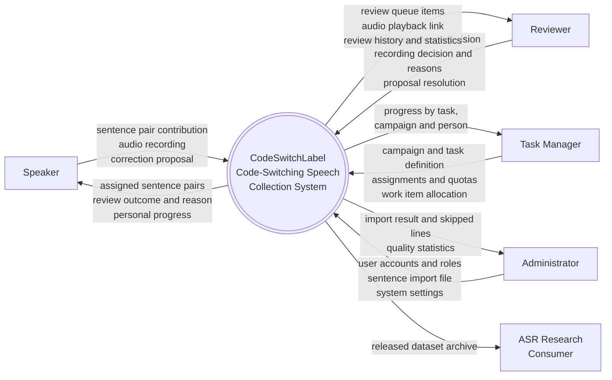

# Nội dung cho Report 3 — Software Requirement Specification

Soạn sẵn để dán sang Google Docs. Viết bằng tiếng Anh cho khớp bảng Actors đã điền trong doc.

**Mỗi mục dưới đây ghi rõ nó thay cho mục nào trong template.** Bảng Markdown dán vào Google Docs
sẽ thành bảng thật (dán xong bấm *Paste without formatting* thì mất bảng — dùng Ctrl+V thường).

Mọi con số và luật trong tài liệu này **lấy từ hệ thống đang chạy**: ràng buộc và trigger trong
`docs/codeswitchlabel.sql`, cấu hình trong bảng `system_config` trên máy chủ, và các thuộc tính
`[Authorize]` trong mã nguồn. Không có chỗ nào tự đặt ra.

Phần **Screens Flow (3.1.1)**, **Screen Descriptions (3.1.2)** và **mock-up trong 3.2/3.3** không
nằm trong file này — đó là phần của BA/FE vì chúng mô tả giao diện.

---

## 1. Product Overview

> Thay cho mục `II. 1. Product Overview`

CodeSwitchLabel is a web system for collecting and quality-controlling a Vietnamese–English
code-switching speech corpus for Automatic Speech Recognition (ASR) training.

Vietnamese speakers frequently mix English words into Vietnamese sentences ("Em nên **scan** tài
liệu này"). Speech recognisers trained on monolingual Vietnamese handle these utterances poorly,
and no sizeable open corpus of such speech exists. The system organises the work of building one:
collecting sentence pairs, assigning recording work, capturing audio, and putting every recording
through independent human review before it can enter a released dataset.

The unit of data is a **sentence pair**: a code-switched sentence and its pure-Vietnamese
equivalent, carrying a word-level alignment between the English words and their Vietnamese
meanings. Both halves of a pair are read by the **same speaker**, so the two recordings differ only
in wording, not in voice. A pair is usable only when both recordings are approved.

### Context diagram

The system boundary and its external entities:

| External entity | Direction | What crosses the boundary |
|---|---|---|
| Speaker (browser) | in / out | Sentence contributions, audio uploads; assigned sentences, review outcomes, personal progress |
| Reviewer (browser) | in / out | Content decisions, recording decisions, rejection reasons; review queues, audio playback |
| Task Manager (browser) | in / out | Campaigns, tasks, assignments, quotas; progress dashboards |
| Administrator (browser) | in / out | Users, sentence imports, system settings, dataset releases; statistics |
| Object storage (MinIO, S3-compatible) | out / in | Audio files written on upload, read back through time-limited presigned links |
| FFmpeg / FFprobe | out / in | Audio handed to the analyser; duration, volume and silence measurements returned |
| ASR research consumer | out | Released dataset archives (audio plus transcript metadata) |

**Lưu ý về phạm vi biên hệ thống.** PostgreSQL, MinIO và FFmpeg **nằm trong** biên — chúng là bộ
phận của sản phẩm, không phải hệ thống bên ngoài, nên không xuất hiện trong context diagram. Hệ
thống này gần như tự chứa: nó không tích hợp với hệ thống nghiệp vụ nào của bên thứ ba, nên số
thực thể ngoài ít hơn ví dụ mẫu trong template. Đó là đặc điểm của bài toán, không phải thiếu sót.

Sơ đồ kiến trúc (khác context diagram — nó vẽ **bên trong** biên) vẽ sẵn ở
`docs/diagrams/01-architecture.mmd` — mở bằng [mermaid.live](https://mermaid.live) rồi xuất PNG.

---

## 2.2 Use Cases

> Thay cho bảng ở mục `II. 2.2 Use Cases`. Sơ đồ use case (2.2.1) vẽ từ bảng này.

| # | Use Case | Actor(s) | Outcome |
|---|---|---|---|
| UC-01 | Register as speaker | Guest | A speaker account exists with a voice profile, ready to receive recording work |
| UC-02 | Sign in | All actors | The actor holds an access token carrying their role |
| UC-03 | Contribute a sentence pair | Speaker | A new pair enters content review |
| UC-04 | Import sentence pairs from file | Administrator | A batch of pairs enters content review; rejected lines are reported with reasons |
| UC-05 | Edit a pending sentence pair | Administrator | The wording of a pair is corrected before it is approved |
| UC-06 | Review sentence content | Reviewer, Administrator | A pair is approved into the recording pool, corrected, or rejected |
| UC-07 | Record a sentence pair | Speaker | Two audio takes are stored and queued for review |
| UC-08 | Re-record a rejected pair | Speaker | New takes replace the discarded ones and re-enter review |
| UC-09 | Review a recording | Reviewer | An independent blind vote is cast; the majority closes the recording as approved or rejected |
| UC-10 | Discard a recording's audio | Reviewer, Task Manager, Administrator | The audio is removed and the sentence returns to the same speaker to record again |
| UC-11 | Discard a sentence pair | Reviewer, Task Manager, Administrator | The pair leaves circulation entirely |
| UC-12 | Report or propose a correction to an approved sentence | Speaker | A proposal enters the reviewer queue and the sentence is held out of recording |
| UC-13 | Resolve a sentence proposal | Reviewer | The proposal is accepted (new wording applied) or rejected, and the sentence returns to the pool |
| UC-14 | Create and manage a campaign | Task Manager, Administrator | A collection round exists with a target, a window and an owner |
| UC-15 | Create and manage a task | Task Manager, Administrator | A unit of recording or review work exists with a target and a deadline |
| UC-16 | Assign people to a task | Task Manager, Administrator | Assignees hold individual quotas that sum to the task target |
| UC-17 | Add sentences or recordings to a task | Task Manager, Administrator | Work items are allocated to the task, by hand or auto-filled by topic |
| UC-18 | Track personal progress | Speaker, Reviewer | The actor sees their own quota, submissions and outcomes |
| UC-19 | Track team progress | Task Manager, Administrator | Progress per task, per campaign and per person is visible |
| UC-20 | Manage users | Administrator | Accounts are created, locked, unlocked, re-roled, and passwords reset |
| UC-21 | Build and release a dataset | Administrator | Approved recordings are packaged into an immutable release |
| UC-22 | Download a released dataset | Administrator | The archive is streamed to the consumer |
| UC-23 | View quality statistics | Administrator, Reviewer | Approval rates, rejection reasons and speaker/reviewer standings are visible |
| UC-24 | Change system settings | Administrator | Thresholds such as required review rounds take effect without a redeploy |

---

## 3.1.3 Screen Authorization

> Thay cho bảng ở mục `3.1.3`. Lấy trực tiếp từ các thuộc tính `[Authorize(Roles = …)]` trong mã
> nguồn, nên đây là quyền **thật sự được hệ thống cưỡng chế**, không phải mô tả mong muốn.

| Feature area | Speaker | Reviewer | Task Manager | Admin |
|---|---|---|---|---|
| Sign in, view own profile | X | X | X | X |
| Register speaker account | X (guest) | | | |
| Browse sentence pool, view a pair | X | X | X | X |
| Contribute a sentence pair | X | | | |
| Import sentence pairs from file | | | | X |
| Edit a pending pair / delete / deactivate / reactivate | | | | X |
| Review sentence content | X¹ | X | | X |
| Text review queue, pending contributions | | X | | |
| Assign a text-review batch to a task | | | X | X |
| Get next sentence to record | X | | | |
| Upload a recording | X | | | |
| Rejected pairs waiting to be re-recorded | X | | | |
| Own recording history, contribution history, proposal history | X | | | |
| Own progress, rounds, leaderboard, statistics | X | | | |
| Submit a sentence proposal | X | | | |
| Proposal queue, resolve a proposal | | X | | |
| Recording review queue, next recording, submit a review | | X | | |
| Discard recording audio / discard a pair | | X | X | X |
| Reviewer progress, statistics, review history | | X | | |
| Campaigns: create, edit, delete, add tasks | | | X | X |
| Assign a manager to a campaign | | | | X |
| Tasks: create, edit, cancel, delete | | | X | X |
| Task items and assignments | | | X | X |
| Task Manager overview, assignable users | | | X | X |
| Users: create, edit, lock, re-role, reset password | | | | X |
| Datasets: build, release, archive, delete, download | | | | X |
| Admin dashboard and statistics | | | | X |
| Read system settings | X | X | X | X |
| Change system settings | | | | X |

¹ A Speaker may act on the content-review endpoint for their own contributions; the queue screens
themselves belong to Reviewers.

---

## 3.1.4 Non-Screen Functions

> Thay cho bảng ở mục `3.1.4`.

| # | Feature | System function | Description |
|---|---|---|---|
| 1 | Recording intake | Automatic audio QC | Every upload is measured with FFprobe/FFmpeg before it reaches a human: duration, mean volume, peak level, leading and trailing silence. A failing take is stored as `qc_failed` and never enters the review queue, so reviewers never spend a round on unusable audio. |
| 2 | Recording intake | Recording identifier generation | Builds the recording id from the sentence id and the variant, with an auto-incrementing take number for re-records. |
| 3 | Sentence intake | Sentence identifier generation | Builds the sentence id from the English word count, the topic and the alignment relation, with the serial drawn from a per-combination database sequence so two concurrent imports cannot collide. |
| 4 | Sentence intake | Duplicate detection | A unique index on the hash of the code-switched sentence rejects a duplicate before it is stored, whichever route it arrives by. |
| 5 | Work queues | Queue synchronisation | Database triggers place a sentence into the content-review queue or the recording queue as its status changes, so a sentence cannot skip a stage even if a row is written by raw SQL. |
| 6 | Work queues | Claim expiry | A queue item claimed by a worker is released automatically after `queue.claim_ttl_minutes` (currently 30) so an abandoned claim does not block everyone else. |
| 7 | Review | Majority decision | A database trigger closes a recording as soon as one side reaches a majority of `review.rounds_required`, and records the outcome. |
| 8 | Review | Pair-wide rejection | When a recording is rejected, the other take of the pair is retired as well, so the speaker re-records the pair rather than splicing a new half onto an old one. |
| 9 | Task tracking | Progress recalculation | Submitting a recording or a review recalculates the owning task's progress and status, and cascades to the campaign. |
| 10 | Task tracking | Quota allocation | Sentences in a recording task are distributed among assignees according to their quotas; items already started keep their owner. |
| 11 | Audit | Change log | Inserts, updates and deletes on users, sentences, recordings, reviews, tasks, campaigns, proposals and datasets are written to a partitioned audit table. |
| 12 | Storage | Presigned audio links | Audio is never served from the application; each playback request returns a link to object storage that expires after 15 minutes. |
| 13 | Dataset | Release packaging | Builds an archive of approved recordings with their transcripts and streams it on download. Released datasets are immutable. |
| 14 | Operations | Nightly database backup | A cron job on the server dumps the database and rotates the archives. |
| 15 | Operations | Continuous integration and deployment | Every push builds the solution with warnings treated as errors and runs the full test suite; a successful build on the release branch deploys to the server, applying any new database migration before the containers are rebuilt. |

---

## 3.1.5 Entity Relationship Diagram — Entities Description

> Thay cho bảng `Entities Description` ở mục `3.1.5`. Sơ đồ ERD vẽ sẵn ở
> `docs/diagrams/02-erd.mmd`, mở bằng mermaid.live rồi xuất ảnh.

| # | Entity | Description |
|---|---|---|
| 1 | `role` | The four system roles: Speaker, Reviewer, Task Manager, Administrator |
| 2 | `app_user` | An account, its role and its lifecycle state (active, locked) |
| 3 | `speaker_profile` | Voice attributes of a speaker — gender, birth year, region — used to describe corpus coverage |
| 4 | `user_domain` | Which topics a reviewer is qualified to judge |
| 5 | `system_config` | Runtime settings such as required review rounds and audio QC thresholds, changeable without redeploy |
| 6 | `audit_log` | Partitioned record of every change to the tables that matter |
| 7 | `import_batch` | One file import of sentence pairs, with its accepted and skipped counts |
| 8 | `script` | A sentence pair: the code-switched sentence, its pure-Vietnamese equivalent, topic and status |
| 9 | `script_word` | The word-level alignment of a pair: each English word and its Vietnamese meaning |
| 10 | `script_error_reason` | The catalogue of reasons for rejecting sentence content |
| 11 | `script_review` | One content decision on a pair: accepted, edited or rejected, with the reason |
| 12 | `script_proposal` | A speaker's report or suggested correction on an already approved pair |
| 13 | `campaign` | A collection round with a target quantity, a date window and an owning manager |
| 14 | `campaign_registration` | A speaker's participation in a campaign |
| 15 | `task` | A unit of recording or review work with a target, a deadline and a status |
| 16 | `task_assignment` | A person assigned to a task, with their individual quota |
| 17 | `task_script` | A sentence pair allocated to a recording task, optionally to a specific speaker |
| 18 | `script_queue` | The work queue: which stage a sentence waits at, who holds it, and when that claim expires |
| 19 | `recording` | One audio take of one half of a pair, its QC measurements and its review outcome |
| 20 | `task_recording` | A recording allocated to a review task |
| 21 | `rejection_reason` | The catalogue of reasons for rejecting a recording, grouped by category |
| 22 | `review` | One independent blind vote on a recording |
| 23 | `review_rejection_reason` | The reasons attached to a rejecting vote |
| 24 | `dataset` | A packaged release of approved recordings |
| 25 | `dataset_recording` | The recordings inside a release; immutable once the release is published |

---

## 4.1 External Interfaces

> Thay cho mục `4.1`.

**User interface.** A browser-based single-page application. Speakers need microphone permission;
all other work needs only a browser. The interface is in Vietnamese.

**Hardware interface.** The speaker's microphone, reached through the browser's media API. No
other hardware is required.

**Software interfaces.**

| Interface | Protocol | Purpose |
|---|---|---|
| REST API | HTTPS/JSON, bearer token | Every client operation. The contract is published as OpenAPI and browsable through Swagger UI. |
| Object storage | S3 protocol | Audio storage. Playback uses presigned links valid for 15 minutes; the application never proxies audio bytes. |
| PostgreSQL | TCP, pooled connections | All persistent data. Business invariants are enforced inside the database, not only in application code. |
| FFmpeg / FFprobe | Local process | Audio measurement during automatic QC. |

**Communication interface.** HTTPS only, with certificates obtained and renewed automatically.
Uploads are capped at 25 MB per request at the reverse proxy.

---

## 4.2 Quality Attributes

> Thay cho mục `4.2`. Các con số dưới đây là giá trị **đang chạy thật**, đọc từ bảng
> `system_config` và cấu hình triển khai trên máy chủ.

### 4.2.1 Usability

- A speaker who has signed in can reach the recording screen and submit a first pair without
  training; the screen shows the sentence, the microphone control and the remaining takes.
- Every rejection reaches the speaker as a sentence in Vietnamese, not a code: a rejected recording
  carries the reviewer's comment, or the description of the reasons chosen when no comment was
  written.
- The system never reports a bare failure where it can state the cause: an action that cannot be
  performed returns a message naming the rule that blocked it (see the message list in 5.3).
- Recording guidance (maximum duration, acceptable silence at either end) is shown to the speaker
  before they record, using the same thresholds the automatic QC applies.

### 4.2.2 Reliability

- **Availability.** The service targets availability during working hours; the deployment is a
  single virtual machine, so planned restarts are the main interruption and last under a minute.
- **Correctness over availability.** Every business invariant that matters is enforced by the
  database — identifier format, one voice per pair, one active take per variant, duplicate
  sentences, dataset immutability — so a defect in application code, or a direct SQL write, cannot
  corrupt the corpus.
- **Recovery.** The database is dumped nightly and the archives are rotated; a copy is kept off the
  server. A deployment takes a backup before it applies any migration, and stops rather than
  attempting an automatic restore if a step fails.
- **Defect control.** The solution is built with compiler warnings treated as errors and ships only
  when the full automated test suite passes — currently **405 test declarations** exercising
  **498 cases**, run against a real PostgreSQL instance rather than a stub.
- **Data integrity under concurrency.** Operations that two people can perform at the same moment —
  claiming a sentence, submitting the deciding review — are serialised with row locks and guarded
  by unique indexes, so a race produces a clear refusal rather than duplicated or lost work.

### 4.2.3 Performance

- **Response time.** Interactive requests complete well inside one second on the current deployment;
  audio never passes through the application, so playback and upload speed are bounded by object
  storage rather than by the API.
- **Audio QC.** Measurement of a take completes within a few seconds of upload and runs before the
  recording becomes visible to reviewers.
- **Capacity.** The corpus currently holds **14,037 sentence pairs** with 14,008 approved, across
  13 campaigns and 49 tasks. An import accepts up to 100,000 sentences per batch.
- **Pagination.** Every list endpoint is paginated with a maximum page size of 100 rows, so no
  screen can ask the server for an unbounded result.
- **Queue fairness.** A claimed work item is released after 30 minutes, bounding how long one
  abandoned claim can hold up the queue.

### 4.2.4 Security

- Authentication is token-based; every endpoint except sign-in and speaker registration requires a
  valid token, and role requirements are declared per endpoint.
- Passwords are stored hashed; a reset issues a temporary password rather than revealing the old one.
- Audio is reachable only through short-lived presigned links, so a leaked link expires in minutes.
- Changes to users, sentences, recordings, reviews, tasks, campaigns, proposals and datasets are
  written to an audit log.

### 4.2.5 Maintainability

- The backend is layered API → Services → Repositories, and the database schema is the single
  source of truth for business invariants.
- Schema changes ship as numbered migration files recorded in a ledger with checksums, applied
  automatically during deployment.
- Diagrams for architecture, the entity model, ten state machines and four workflows are kept in the
  repository as text (`docs/diagrams/`), so they are versioned alongside the code they describe.

---

## 5.1 Business Rules

> Thay cho bảng ở mục `5.1`. Mỗi luật dưới đây **đang được cưỡng chế bằng ràng buộc hoặc trigger
> trong cơ sở dữ liệu** — nghĩa là ghi SQL thẳng vào bảng cũng không lách được.

| ID | Rule definition |
|---|---|
| BR-01 | A sentence pair consists of a code-switched sentence and its pure-Vietnamese equivalent; both are required and both carry `[vi]`/`[en]` segment tags. |
| BR-02 | A sentence identifier has the form `s_` followed by 9 or 12 digits. The first digit is the number of embedded English words, the second is the topic (1 IT, 2 education, 3 daily life), the third is the English–Vietnamese relation (1 direct translation, 2 contains a proper noun); the rest is a serial number issued by the database. |
| BR-03 | A sentence may contain between one and nine English words. |
| BR-04 | The first three digits of a sentence identifier must agree with the sentence's own word count, topic and alignment; the agreement is checked again when the transaction commits. |
| BR-05 | Two sentences may not have the same code-switched content. |
| BR-06 | A sentence enters the pool as *pending validation* and becomes recordable only after a content review by a reviewer qualified for its topic. |
| BR-07 | Editing an approved sentence may not change the number of English words, the topic, or the English–Vietnamese relation, because all three are encoded in its identifier. |
| BR-08 | A sentence that already has recordings may not have its wording changed, because the existing audio would no longer match the transcript. |
| BR-09 | A recording identifier has the form `r_cs_` or `r_vi_` followed by the digits of its sentence, plus a take number for re-records; the prefix must match the variant and the digits must match the sentence. |
| BR-10 | Both halves of a sentence pair must be recorded by the same speaker. |
| BR-11 | A sentence pair may have at most one active recording per variant — that is, one take that is either awaiting review or approved. |
| BR-12 | Audio is accepted only within the configured duration, volume, peak and silence limits; a take outside them is stored as failed automatic QC and never reaches a reviewer. |
| BR-13 | A recording requires `review.rounds_required` independent blind reviews (currently 3). A reviewer may not review the same recording twice, and may not review their own recording. |
| BR-14 | The outcome is decided by majority as soon as one side reaches it; the remaining rounds are not required because they cannot change the result. |
| BR-15 | Rejecting one recording of a pair retires the other as well, so the speaker re-records the whole pair. |
| BR-16 | A rejected recording does not remove its sentence from the pool: the recording is at fault, not the text. A faulty sentence is raised through a proposal instead. |
| BR-17 | Rejecting a recording requires at least one reason; approving one may not carry a rejection reason. |
| BR-18 | A speaker may report or propose a correction only on an approved sentence that has no recordings yet, and a sentence may have at most one pending proposal. |
| BR-19 | While a proposal is pending, its sentence is held out of the recording queue; resolving the proposal returns it. |
| BR-20 | A work item claimed from a queue is released automatically after 30 minutes. |
| BR-21 | A campaign target must be between 2,000 and 5,000 sentence pairs, and its start date may not be after its end date. |
| BR-22 | A campaign must have an assigned Task Manager before tasks can be created in it. |
| BR-23 | A task inside a campaign must share the campaign's topic, must fall inside the campaign's date window, and the sum of its target with its sibling tasks may not exceed the campaign target. |
| BR-24 | Only a Task Manager may be assigned to own a campaign; only a Task Manager or Administrator may create tasks. |
| BR-25 | A recording task may be assigned only to Speakers and a review task only to Reviewers. |
| BR-26 | Individual quotas on a task must sum exactly to the task target. |
| BR-27 | Reaching the target does not close a task to further work: the target measures progress, it does not lock the work. Only cancelling a task stops it. |
| BR-28 | A sentence pair counts as completed for a task only when both of its recordings are approved. |
| BR-29 | A dataset may contain only approved recordings. |
| BR-30 | Once a dataset is released its contents are immutable. |
| BR-31 | Changes to users, sentences, recordings, reviews, tasks, campaigns, proposals and datasets are recorded in the audit log. |

---

## 5.3 Application Messages List

> Thay cho bảng ở mục `5.3`. Đây là các mã lỗi **thật** hệ thống trả về; cột *Message code* dùng
> chính mã đó thay cho `MSG01`, `MSG02`… để tra cứu được giữa tài liệu và log.

| # | Message code | Message type | Context | Content |
|---|---|---|---|---|
| 1 | `duplicate_content` | Toast, error | Importing or contributing a sentence that already exists | This sentence pair is already in the collection. |
| 2 | `alignment_incomplete` | In red, under the field | The alignment does not cover every English word | Please provide the Vietnamese meaning for each English word. |
| 3 | `en_word_count_out_of_range` | In red, under the field | A sentence has no English word, or more than nine | A sentence must contain between one and nine English words. |
| 4 | `en_word_count_locked` | Toast, error | Editing changes the number of English words | The number of English words cannot change; it is part of the sentence identifier. |
| 5 | `relation_locked` | Toast, error | Editing changes the English–Vietnamese relation | The English–Vietnamese relation cannot change; it is part of the sentence identifier. |
| 6 | `ve_not_pure_vietnamese` | In red, under the field | The Vietnamese half still contains English | The Vietnamese sentence must not contain English words. |
| 7 | `script_not_pending` | Toast, error | Editing a sentence that is no longer pending | Only a sentence awaiting content review can be edited. |
| 8 | `script_already_recorded` | Toast, error | Editing a sentence that already has audio | This sentence already has recordings; changing it would leave the audio mismatched. |
| 9 | `script_not_validated` | Toast, error | Recording a sentence that has not passed content review | Only a sentence that passed content review can be recorded. |
| 10 | `script_owned_by_other_speaker` | Toast, error | Recording a pair another speaker has started | Another speaker has already recorded this pair; both halves must be the same voice. |
| 11 | `recording_already_exists` | Toast, error | Uploading a take for a variant that already has an active one | You already have a recording for this half awaiting review or approved. |
| 12 | `too_many_takes` | Toast, error | Exceeding the re-record limit | This pair has reached the maximum number of re-records. |
| 13 | `recording_not_reviewable` | Toast, error | Reviewing a recording that is already decided | This recording is no longer awaiting review. |
| 14 | `self_review_forbidden` | Toast, error | Reviewing one's own recording | You cannot review a recording you made yourself. |
| 15 | `already_reviewed` | Toast, error | Reviewing the same recording twice | You have already reviewed this recording. |
| 16 | `round_changed` | Toast, error | Another reviewer submitted first | Another reviewer submitted in the meantime. Please reload the recording. |
| 17 | `no_more_rounds` | Toast, error | Submitting after the outcome is decided | This recording already has all the reviews it needs. |
| 18 | `rejection_reason_required` | In red, under the reasons | Rejecting without a reason | Please choose at least one reason for rejecting. |
| 19 | `reasons_not_allowed` | In red, under the reasons | Approving with a rejection reason attached | An approval cannot carry a rejection reason. |
| 20 | `decision_note_required` | In red, under the field | Rejecting a proposal without explaining | Please explain why the proposal is rejected. |
| 21 | `applied_content_required` | In red, under the field | Accepting a problem report without providing the correction | Accepting a report requires the corrected sentence. |
| 22 | `proposal_pending_exists` | Toast, error | A second proposal on the same sentence | This sentence already has a proposal awaiting a decision. |
| 23 | `proposal_already_decided` | Toast, error | Resolving a proposal twice | This proposal has already been decided. |
| 24 | `script_has_pending_proposal` | Toast, error | Recording a sentence held by a proposal | This sentence is on hold while a proposal is reviewed. |
| 25 | `task_not_recordable` | Toast, error | Recording in a task not assigned to the speaker | This task is not assigned to you, or it does not contain this sentence. |
| 26 | `task_not_reviewable` | Toast, error | Reviewing in a task not assigned to the reviewer | This task is not assigned to you, or the recording is no longer waiting in it. |
| 27 | `assignment_quota_not_equal_target` | In red, under the quota fields | Quotas do not sum to the task target | The quotas must add up to the task target. |
| 28 | `target_less_than_assignees` | In red, under the target field | More assignees than the target allows | The target must be at least the number of people assigned. |
| 29 | `target_exceeds_items` | In red, under the target field | Target larger than the sentences in the task | The task does not contain enough sentences for this target. |
| 30 | `task_target_exceeds_campaign` | Toast, error | Task targets exceed the campaign target | The targets of this campaign's tasks would exceed the campaign target. |
| 31 | `task_domain_mismatch_campaign` | Toast, error | Task topic differs from the campaign topic | A task must have the same topic as its campaign. |
| 32 | `task_deadline_outside_campaign` | In red, under the deadline | Deadline outside the campaign window | The deadline must fall inside the campaign window. |
| 33 | `campaign_not_assigned_to_manager` | Toast, error | Creating a task in a campaign with no owner | Assign a Task Manager to this campaign before creating tasks. |
| 34 | `assignee_role_mismatch` | Toast, error | Assigning the wrong role to a task | A recording task takes Speakers and a review task takes Reviewers. |
| 35 | `cannot_remove_last_assignee` | Toast, error | Removing the only assignee | A task must keep at least one assignee. |
| 36 | `assignee_quota_invalid` | In red, under the quota field | A per-person quota below 1 | Each assignee's quota must be at least 1. |
| 37 | `assignee_required` | In red, under the assignee field | Assigning a task with nobody selected | Please choose at least one assignee. |
| 38 | `assignee_not_found` | Toast, error | Changing the quota of someone not on the task | This person is not assigned to the task. |
| 39 | `task_has_work` | Toast, error | Deleting a task that has results | This task already has work recorded against it and cannot be deleted. |
| 40 | `user_has_active_tasks` | Toast, error | Deleting or locking a user still holding work | This account still holds active tasks. |
| 41 | `reviewer_domain_required` | Toast, error | A reviewer without the sentence's topic | You are not assigned to review this topic. |
| 42 | `text_review_already_done` | Toast, error | A second content review in the same round | This sentence has already been reviewed in this round. |
| 43 | `dataset_no_approved_recordings` | Toast, error | Building a dataset with nothing approved | There are no approved recordings to include. |
| 44 | `dataset_not_draft` | Toast, error | Changing a released dataset | A released dataset cannot be changed. |
| 45 | `recording_not_enough_pairs` | Toast, error | Building a dataset from incomplete pairs | Only pairs with both halves approved can be released. |

---

## Những chỗ còn thiếu, không thuộc phần tôi làm

| Mục | Ai làm | Ghi chú |
|---|---|---|
| I. Record of Changes | Cả nhóm | Điền khi sửa doc |
| 2.2.1 Use Case Diagram | BA | Vẽ từ bảng use case ở trên |
| 2.2.2 Use Case Descriptions | BA | Mô tả chi tiết luồng chính/phụ cho từng UC |
| 3.1.1 Screens Flow | BA/FE | Sơ đồ chuyển màn hình |
| 3.1.2 Screen Descriptions | BA/FE | Mô tả từng màn hình |
| 3.2 / 3.3 Feature details | BA/FE | Cần mock-up từng màn hình |
| 3.1.5 ERD (hình) | Xuất từ `docs/diagrams/02-erd.mmd` | Mở mermaid.live, dán nội dung file, xuất PNG |
| 5.2 Common Requirements | BA | |
