# CodeSwitchLabel Use Case Diagram

This diagram summarizes the user-facing workflows implemented in the React frontend. The backend supports more operations than the UI exposes, so API-only actions are intentionally omitted.

```mermaid
flowchart LR
    Visitor[Visitor]
    Speaker[Speaker]
    Reviewer[Reviewer]
    Manager[Task Manager]
    Admin[Admin]

    subgraph System[CodeSwitchLabel Web Application]
        direction TB
        Register([Register as Speaker])
        Login([Sign in])
        Help([View help center])
        Profile([View or update personal profile])
        Password([Change password])

        SpeakerProgress([View contribution progress and history])
        ReviewText([Review assigned text before recording])
        Record([Record speech])
        SubmitRecording([Submit recording])
        ListenTake([Listen to a recording take])
        Rerecord([Re-record speech])
        Contribute([Contribute text or propose a correction])

        ReviewerProgress([View review tasks, progress, and statistics])
        ReviewAudio([Review recordings])
        ListenRecording([Listen to recording])
        SubmitAudioDecision([Submit recording decision])
        RejectRecording([Reject recording])
        RejectionReason([Provide rejection reason])
        ReviewTextQueue([Review contributed or proposed text])
        SubmitTextDecision([Submit text decision])
        RejectText([Reject text])
        ReviewHistory([View review history])

        ManageWaves([Manage waves])
        ManageTasks([Create and manage tasks])
        AssignWork([Assign people and work items])
        SetTarget([Set target and deadline])
        ReassignWork([Reassign work])
        MonitorWork([Monitor task and wave progress])

        AdminDashboard([View dashboard])
        AdminStats([View quality statistics])
        ManageUsers([Manage user accounts and access])
        ManageText([Manage text data])
        ImportText([Import text file])
        ManageRecordings([Browse recordings and review results])
        ManageDatasets([Manage datasets])
        ReleaseDataset([Release dataset])
        DownloadDataset([Download dataset])
        Configure([Configure topics and system settings])
    end

    Visitor --> Register
    Visitor --> Login

    Speaker --> Login
    Speaker --> Help
    Speaker --> Profile
    Speaker --> Password
    Speaker --> SpeakerProgress
    Speaker --> ReviewText
    Speaker --> Record
    Speaker --> Contribute
    Record -.->|«include»| SubmitRecording
    ListenTake -.->|«extend»| Record
    Rerecord -.->|«extend»| Record

    Reviewer --> Login
    Reviewer --> Help
    Reviewer --> Password
    Reviewer --> ReviewerProgress
    Reviewer --> ReviewAudio
    Reviewer --> ReviewTextQueue
    Reviewer --> ReviewHistory
    ReviewAudio -.->|«include»| ListenRecording
    ReviewAudio -.->|«include»| SubmitAudioDecision
    RejectRecording -.->|«extend»| SubmitAudioDecision
    RejectRecording -.->|«include»| RejectionReason
    ReviewTextQueue -.->|«include»| SubmitTextDecision
    RejectText -.->|«extend»| SubmitTextDecision

    Manager --> Login
    Manager --> Help
    Manager --> Profile
    Manager --> Password
    Manager --> ManageWaves
    Manager --> ManageTasks
    Manager --> MonitorWork
    ManageTasks -.->|«include»| AssignWork
    ManageTasks -.->|«include»| SetTarget
    ReassignWork -.->|«extend»| AssignWork

    Admin --> Login
    Admin --> Help
    Admin --> Profile
    Admin --> Password
    Admin --> AdminDashboard
    AdminDashboard -.->|«include»| AdminStats
    Admin --> ManageUsers
    Admin --> ManageText
    ImportText -.->|«extend»| ManageText
    Admin --> ManageRecordings
    Admin --> ManageDatasets
    ReleaseDataset -.->|«extend»| ManageDatasets
    DownloadDataset -.->|«extend»| ManageDatasets
    Admin --> Configure
```

**Implementation note:** Reviewer profile editing is currently mock-only in the frontend; password changes use the backend API. Admin recording review/discard actions that exist only in the API are not shown because the frontend does not expose them.
